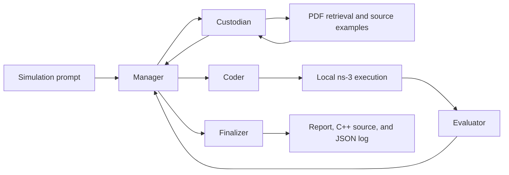

# agens-3

### Natural language to ns-3 network simulations

agens-3 is a research prototype that turns a fully specified network scenario into an ns-3 simulation. A LangGraph workflow coordinates specialist agents to retrieve documentation, write C++ code, compile and run it locally, evaluate the output, and produce a final report.

**Authors:** Kemal Yağız Daşkıran and Ali Berat Ak · Istanbul Technical University

[Project paper](docs/agens-3.pdf) · [Architecture](docs/architecture.md) · [Example scenarios](examples/prompts) · [Development](CONTRIBUTING.md)

## What the project demonstrates

- **Agent orchestration:** a Manager delegates tasks to a Custodian, Coder, and Evaluator, followed by a Finalizer.
- **Retrieval augmented generation:** Chroma stores PDF documentation embeddings; tools also read example source directly from an ns-3 installation.
- **Execution and feedback:** generated simulations compile and run through the local ns-3 launcher. Exit status, compiler errors, warnings, and output are returned for evaluation and revision.
- **Traceable results:** each completed workflow saves a JSON log and the latest generated C++ source.



## Quick start

Requires **Python 3.11–3.13**, an OpenAI API key, and a separately built **ns-3 3.46 family** installation. Python dependencies do not install the simulator. Linux and macOS are the intended execution environments.

```bash
python3.12 -m venv .venv
source .venv/bin/activate
python -m pip install -e .
cp .env.example .env
```

Edit `.env` to set `OPENAI_API_KEY` and `NS3_DIR` to your ns-3 source directory. Existing environment variables take precedence over `.env`. `OPENAI_MODEL` defaults to `gpt-5-mini` and can be changed to a model supporting structured responses.

Build ns-3 separately, following its [official installation guide](https://www.nsnam.org/docs/release/3.46/installation/singlehtml/index.html). From inside that installation:

```bash
./ns3 configure --enable-examples
./ns3 build
```

Check the configuration without making API calls:

```bash
agens3 doctor
```

For documentation retrieval, download the matching ns-3 Manual and Model Library from the [official documentation](https://www.nsnam.org/documentation/) into `documents/`, then index them:

```bash
agens3 ingest
```

Ingestion uses OpenAI embeddings. It skips PDF filenames already indexed. If you replace a PDF or change embedding models, use a fresh `VECTOR_DB_DIR` and ingest again. The workflow can also use local source examples when the PDF collection is empty.

Run a scenario from the repository root:

```bash
agens3 run --prompt-file examples/prompts/tcp_bulk_send.txt
```

Or provide your own scenario:

```bash
agens3 run --prompt "Create a two-node point-to-point UDP echo simulation with a 5Mbps link, 2ms delay, and a 10-second duration. Report received packets."
```

Completed runs save `outputs/workflow_<id>.json` and `outputs/workflow_<id>.cc`. Generated ns-3 source is also retained in the simulator's `scratch/` directory under a unique name. The JSON includes the question, agent decisions, retrieved context, execution observations, and final answer. Model calls and embeddings incur API usage charges. Generated code executes on the local machine; use this prototype in an isolated development environment.

## Repository layout

```text
src/agens3/          Installable package and CLI
  workflow.py       LangGraph routing and specialist node functions
  models.py         Structured agent responses and graph state
  prompts.py        Role prompts from the research prototype
  config.py         Environment configuration
  knowledge_base.py PDF ingestion and Chroma initialization
  tools/            Source examples, semantic search, and simulation execution
examples/prompts/   UDP echo, TCP bulk send, and Wi-Fi 6 scenarios
docs/               Project paper and architecture
tests/              Offline tests for routing, tools, and configuration
scripts/            Clean source export utility
archive/            Preserved prototypes, Streamlit assets, and development notes
.github/workflows/  Automated Python checks
```

`archive/` preserves earlier development work, including the Streamlit/Pinecone prototype and alternate graph implementations. These are historical reference files with their original assumptions and dependencies; `agens3` is the supported entry point.

## Research and validation

The [attached project paper](docs/agens-3.pdf) discusses UDP echo, TCP bulk send, and Wi-Fi 6 experiments. The prompts in `examples/prompts/` describe these scenario families. They are starting points, rather than a reproduction harness for every published measurement.

The automated suite checks orchestration and local tool behavior using simulated model responses and mocked simulator processes. It does **not** establish ns-3 correctness, reproduce the paper's results, or guarantee that a generated simulation satisfies its specification. Live experiments require your configured API access and ns-3 build. The Manager is capped at 15 planning iterations; the Custodian is capped at six retrieval attempts per assignment.

For local checks:

```bash
python -m pip install -e ".[dev]"
ruff check src tests scripts
ruff format --check src tests scripts
pytest
```

## Attribution

This project builds on the GenOnet research and the original repository's code and attribution. The agens-3 paper is authored by Kemal Yağız Daşkıran and Ali Berat Ak. See [NOTICE.md](NOTICE.md) for the inherited citation and licensing status. No new license is asserted for inherited code.
